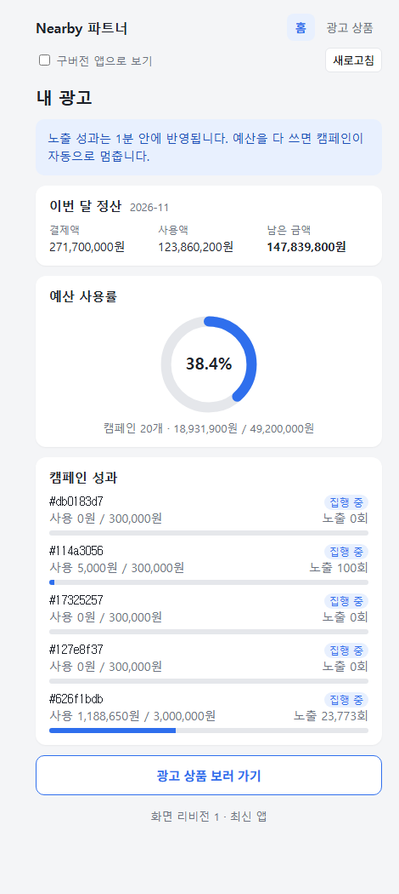
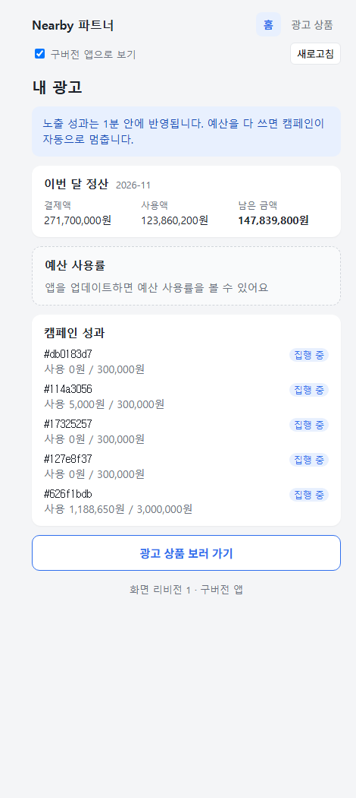
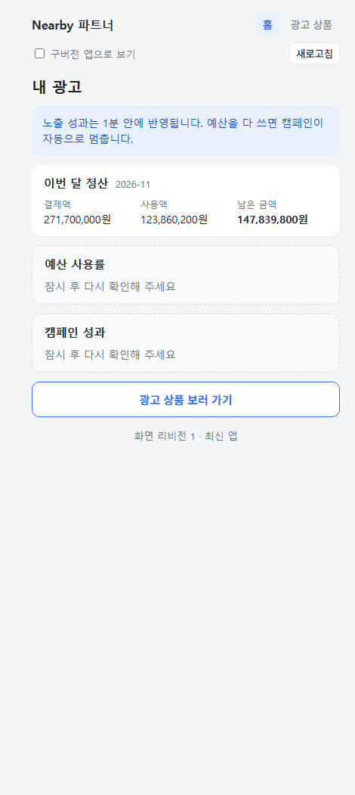

# ad-commerce-lab

현업에서 겪은 불편을 "이런 구조라면 어떨까?"로 바꿔, 가상의 광고 커머스 플랫폼에서 직접 만들어 검증해 보는 실험 프로젝트입니다.

| 현업에서 겪은 불편 | 시험해 보는 구조 |
| --- | --- |
| 외부 PG가 느려지면 우리 서비스 전체가 같이 느려진다 | 업무 경계 MSA, Kafka 비동기 결제, 서킷 브레이커·타임아웃, 결과 자동 재조회, PG가 받지 않은 결제 보류 |
| 화면 문구 하나 바꾸는데 앱 배포를 기다려야 한다 | Server-Driven UI(서버가 화면 스키마를 내려주고, 영역별로 장애를 격리) |
| 운영·CS 요청이 결국 개발자에게 온다 | AI 운영 에이전트(MCP 도구) + 금액·한도·승인은 서버 정책 코드가 결정 |

> 판단은 에이전트가, 금액과 상태는 코드가 결정한다.

| 파트너 앱 홈(서버가 내려준 화면) | 구버전 앱 | 성과 조회 서비스 장애 |
| --- | --- | --- |
|  |  |  |

## 문서

기획 → 설계 → 개발 → 검증 순서로 나눠 남깁니다. [문서 지도](docs/README.md)

## 상태

| 단계 | 내용 | 상태 |
| --- | --- | --- |
| 기획 | 문제 정의, 시나리오 17개, 요구사항, 로드맵 | 완료 |
| 설계 | 아키텍처, 서비스 경계, 도메인·이벤트·API 명세, ADR | 완료 |
| M1 구매·결제 코어 | 멱등키, 상태 머신, Transactional Outbox → Kafka, Saga 보상 | 완료 ([흐름](docs/03-development/flow-m1.md)) |
| M2 장애 격리·관측 | 서킷 브레이커, 결과 재조회, 장애 주입(Toxiproxy), 분산 트레이싱, 지표, S4~S6 전후 비교 | 완료 ([흐름](docs/03-development/flow-m2.md), [실험 결과](docs/04-verification/m2-resilience.md)) |
| M3 노출·과금·정산 | 노출 수집(초당 1만 건 확인), 배치 과금·예산 차감, 복식부기 원장(DB 트리거), 정산서 | 완료 ([흐름](docs/03-development/flow-m3.md), [실험 결과](docs/04-verification/m3-billing.md)) |
| M4 서버 주도 화면 | SDUI BFF(리비전 설정·출처별 대체 표시·버전 맞추기), React 렌더러, 운영자 권한 | 완료 ([흐름](docs/03-development/flow-m4.md), [실험 결과](docs/04-verification/m4-sdui.md)) |
| M5 AI 에이전트 | MCP 도구 서버(Python), 위임 한도(예약·행 잠금), 사람 승인(SDUI 승인 화면), 멱등, 감사 로그, 부분 환불 Saga, 주입 평가(17케이스 정책 위반 실행 0건) | 완료 ([흐름](docs/03-development/flow-m5.md), [평가 결과](docs/04-verification/m5-agent.md)) |

## 실행

```bash
./gradlew bootJar && docker compose -f infra/docker-compose.yml up -d --build
bash scripts/e2e-m1.sh            # 정상 흐름 스모크
bash scripts/e2e-m3.sh            # 주문 → 노출 → 과금 → 정산서
bash scripts/experiments/m2.sh s5  # 장애 실험(S4~S6)
bash scripts/experiments/m3.sh s7  # 노출 부하 실험(S7~S9)
bash scripts/experiments/m4.sh s10 # 서버 주도 화면 실험(S10~S12)
bash scripts/experiments/m5.sh eval # 에이전트 주입 평가(S13~S17), agent/.venv 필요(cd agent && uv sync)
python scripts/trace.py            # 최근 주문 하나의 분산 트레이스
```

| 화면 | 주소 |
| --- | --- |
| 파트너 앱(SDUI 렌더러) | http://localhost:5173 |
| API(gateway, 파트너 키 `demo-partner-key`, 운영자 키 `demo-operator-key`) | http://localhost:8080 |
| MCP 도구(에이전트 키 `demo-agent-key` + `X-Mandate-Id`, 운영 에이전트 키 `demo-ops-agent-key`) | http://localhost:8080/api/agent/mcp/partner, http://localhost:8080/api/admin/agent/mcp/ops |
| Grafana 대시보드 "M2 장애 격리" | http://localhost:3000 |
| Jaeger(트레이스) | http://localhost:16686 |
| Kafka UI(토픽·컨슈머 지연) | http://localhost:8089 |
| Prometheus | http://localhost:9090 |

## 기술

Kotlin · Spring Boot · Spring Cloud Gateway · PostgreSQL · Kafka · Resilience4j · OpenTelemetry · Prometheus · Grafana · Python · FastAPI · MCP · React · Docker Compose · k6 · Toxiproxy
