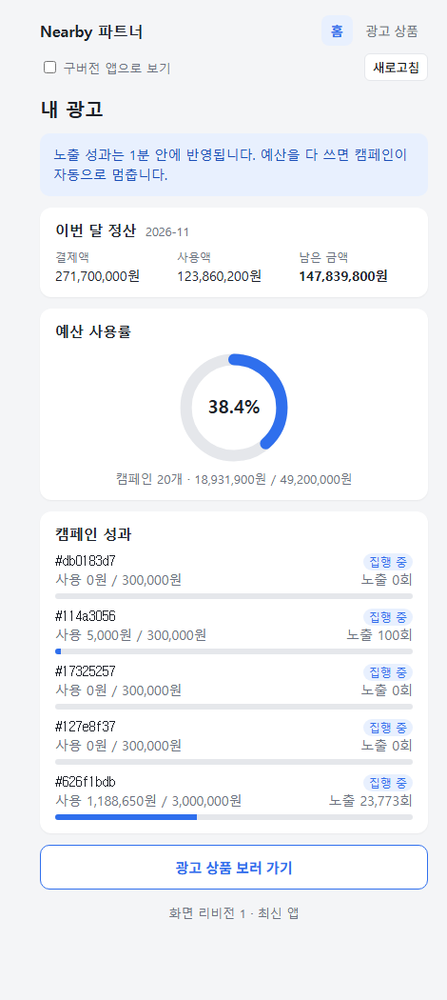
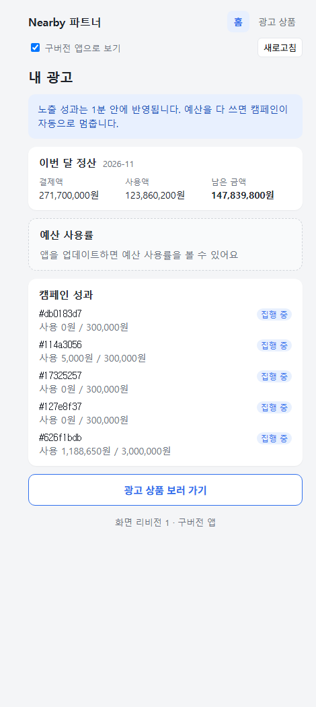
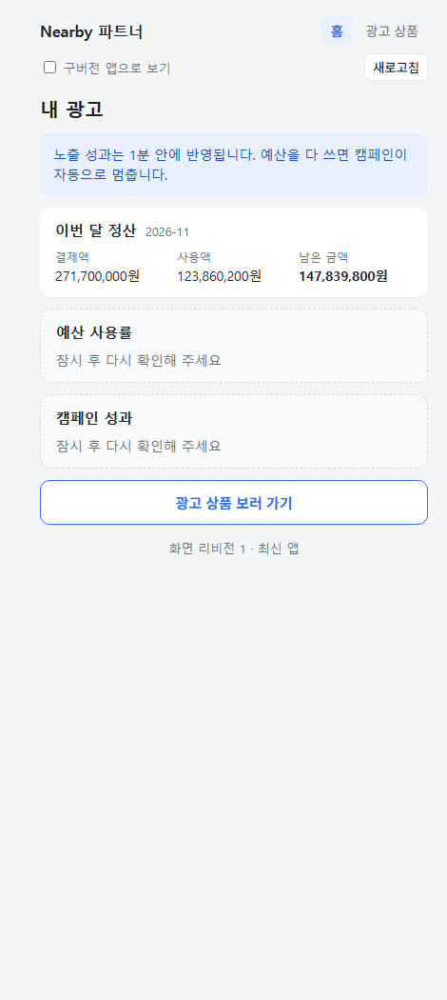

# 앱 배포 없이 화면 바꾸기: SDUI를 직접 만들어 보며 정한 경계

> ad-commerce-lab 개발 기록 3편. [2편](02-billing-impressions-within-budget.md)까지는 돈이 오가는 뒤쪽을 만들었다. 이번에는 파트너가 보는 화면이다. 코드와 실험 스크립트는 [저장소](https://github.com/HYUNWOOL/ad-commerce-lab)에 있다.

광고 상품 구매 화면의 문구 하나, 섹션 순서 하나를 바꾸려고 AOS와 iOS를 각각 배포하고 스토어 심사를 기다린 적이 있다. 기다림보다 곤란했던 건 업데이트하지 않은 사용자였다. 환불 안내 문구를 바꿔도 옛 앱을 쓰는 파트너에게는 끝까지 옛 문구가 보였다. 원격 설정으로 값 몇 개는 바꿀 수 있었지만 화면 구조는 바꿀 수 없었다.

서버 주도 UI(Server-Driven UI, SDUI)는 화면의 구성을 서버가 내려주고 앱은 그리기만 하는 방식이다. 이름만 들으면 "그럼 다 서버가 정하면 되겠네"로 끝날 것 같지만, 직접 만들어 보니 무엇을 서버로 가져오고 무엇을 앱에 남길지가 거의 전부였다. 이 글은 그 경계를 어디에 그었는지에 대한 기록이다.

| 최신 앱 | 구버전 앱 | 성과 조회 서비스 장애 |
| --- | --- | --- |
|  |  |  |

## 경계 1. 서버는 "무엇을 어떤 순서로"만 정한다

화면은 섹션 목록이다. 서버는 `{id, type, version, props}`를 순서대로 내려주고, 앱은 위에서부터 그린다.

```json
{ "screenId": "home", "revision": 3, "sections": [
  { "id": "notice", "type": "Banner", "version": 1, "props": { "text": "노출 성과는 1분 안에 반영됩니다." } },
  { "id": "performance", "type": "CampaignPerformanceList", "version": 2, "props": { "title": "캠페인 성과", "items": [] } }
] }
```

여백, 행과 열, 글자 크기까지 서버가 정하는 범용 레이아웃 언어도 생각했다. 무엇이든 바꿀 수 있지만, 그만큼 디자인 시스템이 서버로 새어 나오고 앱은 서버가 만들 수 있는 모든 조합을 감당해야 한다. 그래서 컴포넌트를 "캠페인 성과 목록", "이번 달 정산"처럼 업무 의미가 있는 단위로 잘랐다. 운영자는 섹션의 순서·문구·노출 여부를 바꾸고, 생김새는 앱이 책임진다.

## 경계 2. 설정은 고치지 않고 쌓는다

운영자가 화면을 바꾸면 `screen_revisions`에 새 리비전이 한 줄 쌓인다. 고치거나 지우지 않는다. 되돌리기도 옛 내용을 새 리비전으로 저장하는 것이다.

두 사람이 동시에 고치는 경우를 막으려고 저장할 때 `baseRevision`을 함께 받는다. 그사이 누가 먼저 저장했으면 409를 돌려준다. 그리고 저장하기 전에 컴포넌트 종류와 버전, 필수 문구, 섹션 id 중복을 검사한다. 설정 실수 하나로 모든 파트너의 화면이 깨지면, 앱 배포를 기다리던 시절보다 나빠진다.

실험에서 환불 안내 문구를 바꾸고 맨 아래로 옮겼다. 저장 응답을 받은 직후의 다음 요청부터 바뀐 화면이 나갔다. 구버전 앱으로 불러도 새 문구가 나왔다. 처음에 겪었던 "옛 앱 사용자에게만 옛 정책이 보인다"는 문제가 이 지점에서 풀렸다.

## 경계 3. 버전은 서버가 맞춘다

새 컴포넌트를 추가하면 옛 앱은 그걸 모른다. 이번에는 "예산 사용률" 게이지(BudgetGauge)를 새로 넣었고, 캠페인 성과 목록은 v2에서 노출 수와 진행률을 추가했다.

앱은 요청할 때 아는 컴포넌트와 버전을 헤더로 보낸다(`X-Client-Components: Banner@1,CampaignPerformanceList@1,...`). 서버는 섹션마다 `min(설정 버전, 앱 버전)`으로 내려보내고, 옛 버전으로 낮출 때 그 버전에 없는 필드를 덜어 낸다. 앱이 아예 모르는 종류면 그 섹션만 대체 표시로 바꾼다.

| 섹션 | 최신 앱 | 구버전 앱 |
| --- | --- | --- |
| 예산 사용률 | BudgetGauge v1 | 대체 표시("앱을 업데이트하면 예산 사용률을 볼 수 있어요") |
| 캠페인 성과 | v2(노출 수·진행률 포함) | v1(두 필드를 빼고 보냄) |
| 나머지 | 같음 | 같음 |

앱도 한 번 더 막는다. 서버가 실수로 모르는 종류를 보내거나 섹션 하나가 그리다 터져도, 렌더러가 섹션 단위로 잡아 그 섹션만 대체 표시한다. 화면 전체가 하얗게 되는 일은 없다.

## 경계 4. 장애는 영역 단위로 받는다

홈 화면은 세 곳에서 데이터를 가져온다. 이번 달 정산은 정산 서비스, 예산 사용률과 캠페인 성과는 노출 과금 서비스(delivery)다. 출처마다 응답 타임아웃 1초와 서킷 브레이커를 두고 병렬로 부르고, 화면 전체에는 1.5초 마감을 걸었다. 실패한 출처를 쓰는 섹션만 "잠시 후 다시 확인해 주세요"로 바꾼다.

delivery 응답을 3초씩 늦추고 홈 화면을 30번 불렀다.

| 상황 | 화면 응답 p50 / p95 | 대체 표시된 섹션 |
| --- | --- | --- |
| 평소 | 65 / 128ms | 없음 |
| delivery 3초 지연 | 63 / 1,027ms | 예산 사용률, 캠페인 성과 |
| delivery 중지 | 57 / 1,315ms | 예산 사용률, 캠페인 성과 |

처음 몇 번은 타임아웃 1초만큼 기다렸고, 실패가 쌓여 서킷이 열린 뒤에는 delivery를 부르지 않고 바로 대체 표시를 내려줬다. 공지와 정산, 버튼은 그대로 보였다.

마지막으로 성공한 값을 캐시해 두었다가 장애 때 보여 주는 방법도 있다. 하지만 이 화면의 숫자는 남은 예산, 쓴 금액이다. 몇 분 전 값을 지금 값처럼 보여 주면 파트너가 그걸 보고 예산을 더 넣거나 캠페인을 멈출 수 있다. 그래서 돈이 걸린 숫자는 모르면 모른다고 보여 주기로 했다.

## 경계 5. 돈의 규칙은 화면으로 옮기지 않는다

광고 상품 화면의 구매 폼도 서버가 내려주지만, 결제하기를 누르면 1편에서 만든 주문 API를 그대로 부른다. 멱등키도 그대로다. 같은 내용으로 다시 누르면 같은 키가 나가서 주문이 두 번 생기지 않는다. 최소 예산, 최대 기간 같은 규칙도 주문 서비스가 검사한다.

화면이 서버 설정으로 바뀌어도 돈과 상태의 규칙은 업무 서비스에 남는다. SDUI가 바꾸는 건 보여 주는 방식이지, 무엇이 허용되는지가 아니다.

## 만들다 걸린 것

서버에서 하위 서비스의 JSON을 섹션 데이터로 바꾸다가, 캠페인 성과 목록이 이상하게 변환됐다. 원인은 Jackson 3의 `JsonNode.map {}`이었다. Kotlin에서 배열 노드에 `map`을 쓰면 원소마다 도는 목록 함수일 거라 생각했는데, Jackson 3의 JsonNode에는 노드 자신에 함수를 적용하는 멤버 `map`이 있었고 Kotlin은 멤버를 먼저 고른다. 배열 전체가 한 원소처럼 다뤄졌다. 테스트를 쓰다가 컴파일 오류로 알아챘고, 원소를 돌 때는 `values()`를 쓰도록 고쳤다.

## 정리

- 서버는 섹션의 종류·순서·문구·노출만 정하고, 생김새는 앱에 남긴다.
- 설정은 리비전으로 쌓고, 저장 전에 검사하고, 동시 수정은 409로 막는다.
- 버전은 서버가 맞춰 보내고, 앱도 모르는 것은 섹션 단위로 대체 표시한다.
- 장애는 출처 단위로 받는다. 돈이 걸린 숫자는 오래된 값으로 보여 주지 않는다.
- 돈과 상태의 규칙은 화면 설정으로 옮기지 않는다.

아직 해 보지 못한 것도 많다. 렌더러는 웹(React) 하나뿐이라, 같은 스키마를 iOS와 Android가 그릴 때의 비용은 재지 않았다. 운영자가 쓰는 건 API뿐이고, 미리보기나 편집 화면은 없다. 화면 응답 캐시도 없어서 많은 파트너가 동시에 부를 때의 부하는 모른다.

다음 글에서는 운영·CS 요청을 AI 에이전트에게 맡기면서도 돈은 코드가 지키게 하는 부분을 다룬다.
