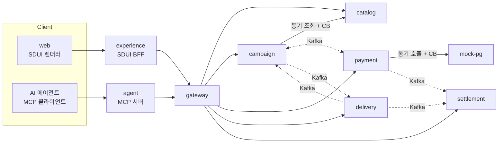

# 1. 아키텍처

## 1.1 전체 그림



실선은 동기 HTTP(호출하는 쪽이 타임아웃·서킷 브레이커·대체 응답을 책임), 점선은 Kafka 이벤트다.

## 1.2 서비스와 나눈 이유

| 서비스 | 포트 | DB | 맡는 일 | 나눈 이유 |
| --- | --- | --- | --- | --- |
| gateway | 8080 | — | 진입점, API 키 인증, 라우팅, 경로별 서킷 브레이커·요청 제한 | 인증·장애 차단을 한곳에서 |
| catalog | 8081 | catalog | 광고 상품·지면·CPV 단가 | 읽기 위주, 변경 주기가 다르다. 장애 시 호출하는 쪽의 대체 응답을 시험할 대상 |
| campaign | 8082 | campaign | 광고 주문·캠페인 상태 머신, 예산·기간, 환불 요청 | 주문·캠페인의 수명주기를 한 곳이 책임 |
| payment | 8083 | payment | 결제 승인·취소, PG 장애 격리, 결과 재조회 | 외부 PG 장애를 이 서비스 안에 가두는 것이 P1의 핵심 |
| delivery | 8084 | delivery | 노출 수집·집계, 과금, 예산 차감 | 처리량 요구가 다른 서비스와 크게 다르다(따로 확장) |
| settlement | 8085 | settlement | 원장, 정산서 | 돈의 최종 기록은 다른 서비스 장애와 분리 |
| experience | 8086 | experience | 파트너 앱·운영 콘솔 화면 스키마(SDUI BFF) | 화면 구성의 변경 주기를 업무 서비스와 분리(P2) |
| agent | 8000 | agent | MCP 도구, 위임 한도, 승인, 감사 로그(Python) | LLM 생태계는 Python. 에이전트 권한을 업무 서비스와 분리(P3) |
| mock-pg | 8090 | 메모리 | 가짜 외부 PG(지연·실패 설정, 조회, 정산 파일) | 외부 시스템 대역 |
| web | 5173 | — | SDUI 렌더러(React) | — |

## 1.3 통신 규칙

| 구분 | 규칙 |
| --- | --- |
| 비동기 | 상태 변경은 Kafka 이벤트로 알린다. 발행은 Transactional Outbox(같은 DB 트랜잭션에 기록 → 릴레이가 발행). 소비는 Inbox(이벤트 ID 기록)로 멱등. 키는 집계 ID(주문·캠페인)로 같은 대상의 순서를 지킨다 |
| 동기 | 조회와 외부 PG 호출에만. 모든 호출에 연결·응답 타임아웃, Resilience4j 서킷 브레이커, 필요하면 벌크헤드. 실패 시 대체 응답 또는 재시도 가능한 오류(503)를 명시적으로 돌려준다 |
| 데이터 | 서비스는 자기 DB만 읽고 쓴다. 다른 서비스 데이터가 필요하면 이벤트로 받아 복제하거나 API로 조회한다 |
| 돈 | 원 단위 정수(Long). 금액 결정은 항상 서버 코드 |

## 1.4 인프라 (Docker Compose)

| 구성 | 포트 | 용도 |
| --- | --- | --- |
| Kafka (KRaft, 단일 브로커) | 9092 | 이벤트 |
| Kafka UI | 8089 | 토픽·컨슈머 지연 확인 |
| PostgreSQL 17 | 5432 | 서비스별 DB(한 인스턴스, DB 분리) |
| ~~Redis~~ | — | 넣지 않음. DB 유니크와 배치 UPDATE로 초당 1만 건을 처리했다(ADR-0007, S7) |
| Toxiproxy | 8474 | PG·서비스 사이 지연·장애 주입(M2) |
| OpenTelemetry Collector, Jaeger, Prometheus, Grafana | 4317, 16686, 9090, 3000 | 관측(M2) |
| k6 | — | 부하 실험(M3) |

## 1.5 코드 구조

하나의 저장소, Gradle 멀티 모듈(ADR-0001).

```
services/
  common/        공통: 이벤트 봉투, Outbox·Inbox, 멱등키, 오류 응답
  gateway/ catalog/ campaign/ payment/ delivery/ settlement/ experience/ mock-pg/
agent/           Python (uv)
web/             React + Vite
infra/           docker-compose, 관측 설정, Toxiproxy, k6
docs/
```
