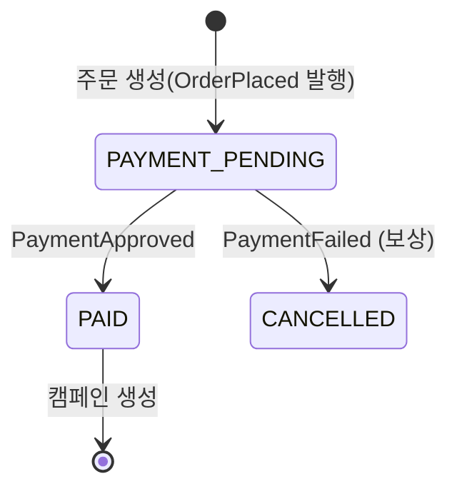
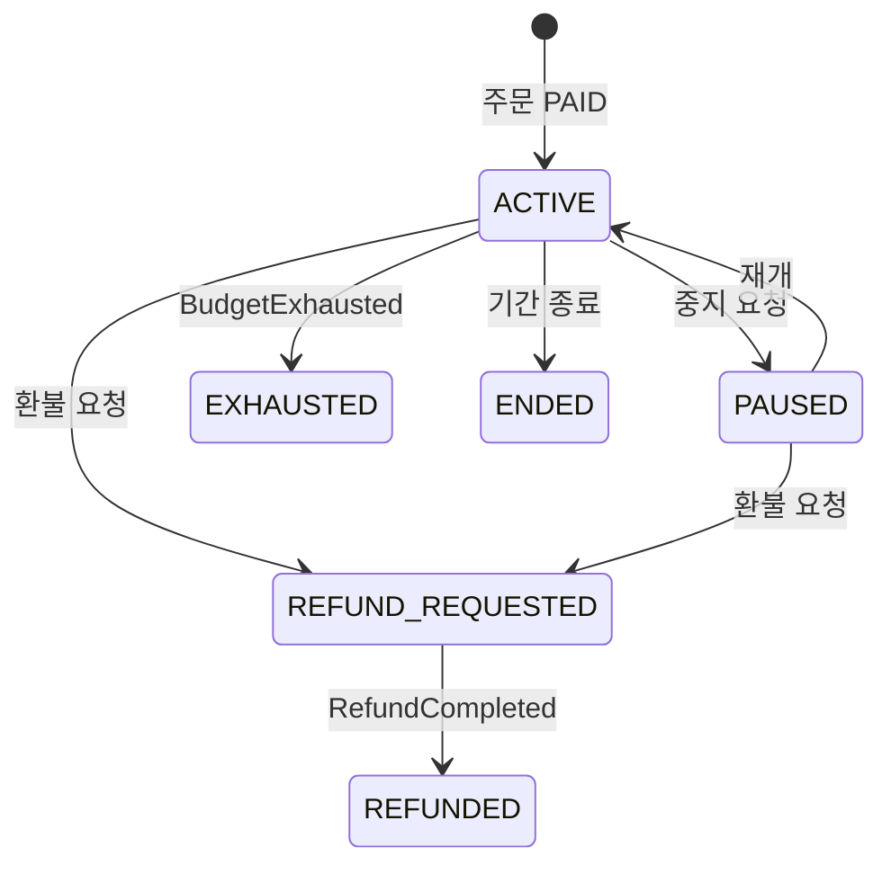
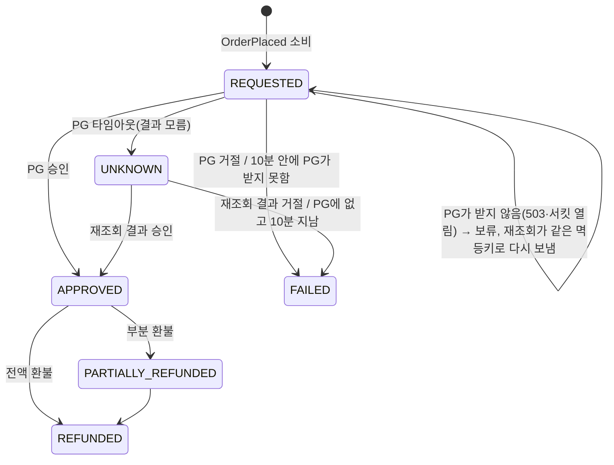

# 2. 도메인 모델과 상태 머신

## 2.1 공통 규칙

- 금액은 원 단위 `Long`. 단가 × 노출 수처럼 곱셈만 쓰고, 나눗셈이 필요하면 내림하고 차액을 기록한다.
- 쓰기 API는 `Idempotency-Key` 헤더 필수. 서비스별 `idempotency_keys`(key, 요청 본문 해시, 응답) 테이블에 저장한다. 같은 키 + 같은 본문 → 저장된 응답, 같은 키 + 다른 본문 → 409.
- 상태 전이는 엔티티의 메서드로만 한다. 허용되지 않은 전이는 예외다(테스트로 고정).

## 2.2 주문 (campaign 서비스)

| 필드 | 설명 |
| --- | --- |
| id, partner_id, product_id | 주문 식별, 파트너, 상품 |
| budget | 예산(= 결제 금액), product.min_budget 이상 |
| cpv_price | 주문 시점 단가 스냅샷(catalog에서 조회) |
| start_date, end_date | 기간, product.max_days 이하 |
| status, failure_reason | 상태, 실패 사유 |

## 2.3 캠페인 (campaign 서비스)

예산·사용액의 원본은 delivery가 가진다(과금 주체). campaign은 이벤트로 받은 사용액을 화면용으로 복제한다.

## 2.4 결제 (payment 서비스)

- 한 주문에 결제는 하나(`order_id` 유니크). PG에는 결제 ID를 멱등키로 보내, 재시도해도 PG에서 한 번만 승인된다.
- `UNKNOWN`은 사람이 확인하는 대신 스케줄러가 PG 조회 API로 확정한다(FR-202, ADR-0004).
- PG가 받지 않은 결제는 바로 실패시키지 않고 보류한다(ADR-0006). 주문은 그동안 PAYMENT_PENDING("결제 확인 중")이다.

## 2.5 노출·과금 (delivery 서비스, M3)

- 노출 이벤트: event_id, campaign_id, placement, occurred_at.
- 과금 단위: Kafka 배치(최대 500건) 하나를 창으로 삼아, 캠페인별 `노출 수 × cpv_price`를 남은 예산 안에서만 차감한다. 남은 예산이 단가보다 작아지면 BudgetExhausted(ADR-0007).
- 중복 제거: event_id DB 유니크(`impression_events`). Redis는 S7 실측 뒤 필요할 때 넣는다.
- 예산·사용액의 원본은 delivery(`campaign_budgets`)다.

## 2.6 원장 (settlement 서비스, M3)

복식부기. 모든 기록은 차변 합 = 대변 합인 분개 한 묶음이다.

| 사건 | 차변 | 대변 |
| --- | --- | --- |
| 결제 승인 | PG 미수금 | 파트너 선수금(광고 예산) |
| 노출 과금 | 파트너 선수금 | 광고 매출 |
| 환불 | 파트너 선수금 | PG 미수금 |
