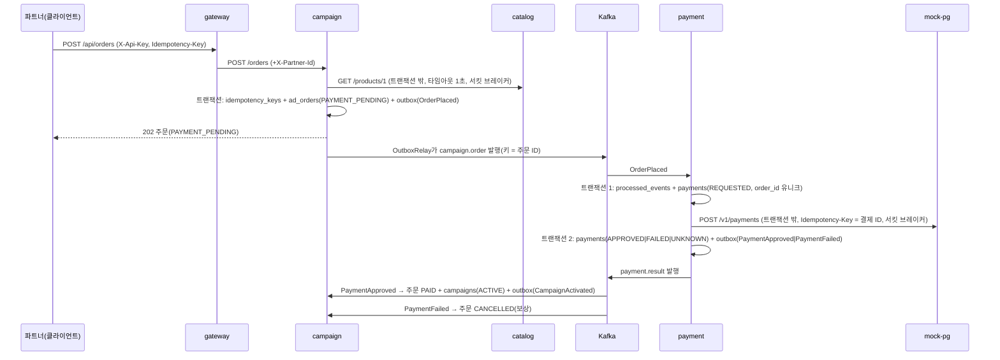

# M1 흐름: 광고 주문 하나가 지나는 길

## 그림



## 단계별 DB 변화

| 단계 | 서비스 | DB 변화 | 이벤트 |
| --- | --- | --- | --- |
| 주문 접수 | campaign | `idempotency_keys` 1행(응답 저장), `ad_orders` PAYMENT_PENDING, `outbox_events` 1행 | — |
| 릴레이 | campaign | `outbox_events.published_at` 채움 | campaign.order: OrderPlaced |
| 결제 생성 | payment | `processed_events` 1행, `payments` REQUESTED | — |
| PG 승인 | payment | (DB 접근 없음) | — |
| 결제 확정 | payment | `payments` APPROVED/FAILED/UNKNOWN, `outbox_events` 1행 | payment.result |
| 결과 반영 | campaign | `processed_events` 1행, `ad_orders` PAID/CANCELLED, 승인이면 `campaigns` ACTIVE + `outbox_events` | campaign.lifecycle: CampaignActivated |

## 실제 실행 로그 (2026-11-21, `bash scripts/e2e-m1.sh`)

```
[0] 키 없이 요청하면 401
  통과: 401
[S1] 30만 원 주문 → 결제 승인 → 캠페인 ACTIVE
  주문 31a55a91-718f-49a4-b816-c7297f5f5f9b 응답 202
  통과: 주문 PAID
  통과: 결제 APPROVED
  통과: 캠페인 ACTIVE
[S2] 같은 멱등키로 10번 → 주문 1건
  응답 코드: 202 200 200 200 200 200 200 200 200 200
  통과: 주문 ID 1개
[S3] 600만 원(카드 한도 초과) → 결제 거절 → 주문 CANCELLED
  통과: 주문 CANCELLED
  통과: 사유 DECLINED
M1 스모크 완료
```

통합 테스트: campaign 8개, payment 4개(Testcontainers Postgres·Kafka) 모두 통과.

## M2로 넘기는 것
- 결제 `UNKNOWN`과 오래 머문 `REQUESTED`를 PG 조회로 확정하는 재조회 스케줄러(FR-202).
- PG 지연·실패 주입(Toxiproxy, mock-pg chaos)과 서킷 브레이커 전후 숫자, 분산 트레이싱.
