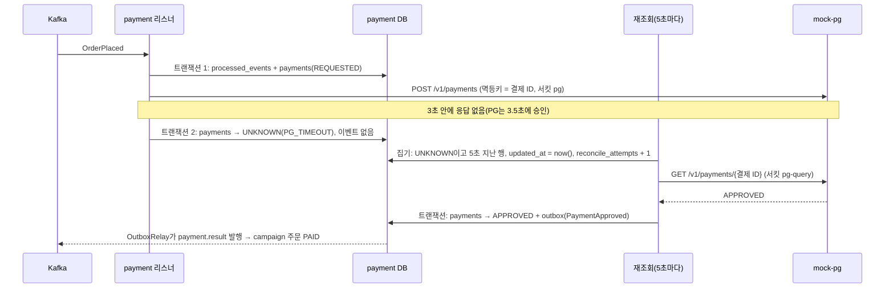
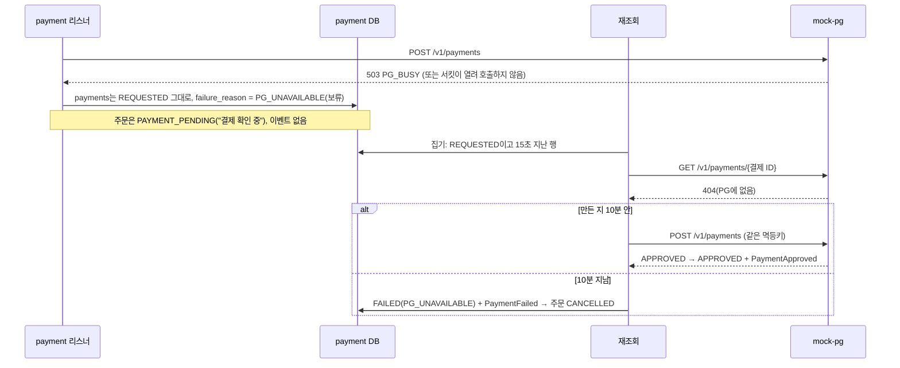

# M2 흐름: PG가 아플 때 결제 하나가 지나는 길

M1의 정상 흐름([flow-m1.md](flow-m1.md))에, PG가 대답하지 못할 때의 두 갈래가 더해졌다. 설계 근거는 ADR-0004(재조회), ADR-0006(보류).

## 그림 1. 결과를 모르는 결제(UNKNOWN) → 재조회로 확정 (S5)



## 그림 2. PG가 받지 않은 결제(503·서킷 열림) → 보류 → 다시 보냄 (S4, ADR-0006)



## 단계별 DB 변화

| 상황 | payments | outbox_events | 주문(campaign) |
| --- | --- | --- | --- |
| 타임아웃 | REQUESTED → UNKNOWN, failure_reason PG_TIMEOUT | — | PAYMENT_PENDING |
| PG가 받지 않음 | REQUESTED 유지, failure_reason PG_UNAVAILABLE | — | PAYMENT_PENDING |
| 재조회가 집음 | updated_at = now(), reconcile_attempts + 1 | — | — |
| PG에 있음(승인) | → APPROVED, failure_reason 지움 | PaymentApproved(trace_parent 포함) | → PAID, 캠페인 ACTIVE |
| PG에 없음, 10분 안 | (같은 멱등키로 다시 보낸 결과로) APPROVED/FAILED | PaymentApproved / PaymentFailed | PAID / CANCELLED |
| PG에 없음, 10분 지남 | → FAILED(PG_UNAVAILABLE) | PaymentFailed | → CANCELLED |
| 조회도 실패 | 그대로(다음 회차) | — | PAYMENT_PENDING |

## 실제 실행 로그 (2026-11-21)

### 결과를 모르는 주문 한 건의 트레이스 (`python scripts/trace.py`)
mock-pg가 3.5초 뒤에 처리하게 해 두고 주문 하나를 넣었다. payment의 PG 호출은 3,004ms에서 타임아웃으로 끊겼고, mock-pg는 3,501ms에 승인을 마쳤다. 그 사이의 어긋남이 UNKNOWN이다.

```
trace acefbd6ec96ea214eb14b3f3874a2303: 스팬 10개, 서비스 5개 ['campaign', 'catalog', 'gateway', 'mock-pg', 'payment']
      0.0ms     45.5ms  gateway: http post /api/orders/**
      0.3ms     44.9ms    gateway: http post
      2.3ms     42.9ms      campaign: http post /orders
      4.9ms      4.4ms        campaign: http get
      6.7ms      1.1ms          catalog: http get /products/{id}
    151.6ms      6.1ms        campaign: outbox publish
    151.8ms      6.3ms          campaign: campaign.order send
    158.9ms   3040.8ms            payment: campaign.order process
    181.8ms   3004.2ms              payment: http post
    184.5ms   3501.0ms                mock-pg: http post /v1/payments
```

- 주문 저장(2ms대)과 `outbox publish`(151ms) 사이의 빈 구간이 Outbox 릴레이 주기(200ms)다. Outbox 행에 저장한 `traceparent` 덕분에 릴레이 뒤에도 같은 트레이스로 이어진다.
- 재조회는 스케줄러 스레드에서 돌아 이 트레이스에 붙지 않는다(결제 행에 traceparent를 저장하지 않았다). 로그로 보면 이렇다.

```
2026-11-21T04:11:16.852 INFO [scheduling-1] 결제 c8278bee-1cd9-4ce2-a7f4-a90666e3b3dc 조회로 확정: UNKNOWN → Approved(transactionId=f0e4fffe-...)
```

주문을 넣은 뒤 PAID가 되기까지 약 10초(타임아웃 3초 + UNKNOWN 뒤 5초 대기 + 재조회 주기).

### S5 실험 (`bash scripts/experiments/m2.sh s5`)

```
[S5-A] PG가 3.5초 뒤에 처리(읽기 타임아웃 3초): 응답은 못 받지만 PG에서는 승인된다
  주문 결과 (상태 | 사유 | 건수 | 확정까지 p50초 | p95초 | 최대초):
    PAID | - | 8 | 13.3 | 17.9 | 17.9
  결제 (상태 | 재조회 횟수 | 건수):
    APPROVED | 1 | 8
  PG가 받은 승인 요청: 8건 (재조회는 조회로 끝나 재승인 없음)
[S5-B] PG로 가는 요청이 20초 동안 닿지 않음(연결은 열리고 데이터는 버려짐) → 복구
  20초 뒤 결제 상태: UNKNOWN 4
  주문 결과 (상태 | 사유 | 건수 | 확정까지 p50초 | p95초 | 최대초):
    PAID | - | 4 | 21.2 | 21.4 | 21.4
  복구 뒤 모두 확정될 때까지: 0.1초
  PG가 받은 승인 요청: 4건 (닿지 않은 첫 요청 대신 같은 멱등키로 다시 보낸 것)
  PG에 기록된 결제: 4 / 4 (결제 ID = 멱등키라 결제마다 하나)
```

S4·S6 숫자는 [m2-resilience.md](../04-verification/m2-resilience.md).

통합 테스트: campaign 8개, payment 11개(재조회 5개, 보류 2개 추가) 모두 통과.
