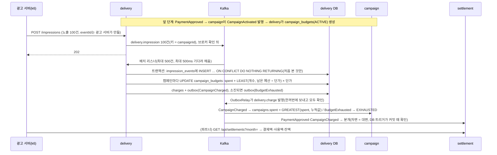

# M3 흐름: 노출 하나가 돈이 되기까지

설계 근거는 ADR-0007(노출 과금), ADR-0008(원장). M1(주문·결제) 흐름 뒤에 이어진다.

## 그림



## 단계별 DB 변화

| 단계 | 서비스 | DB 변화 | 이벤트 |
| --- | --- | --- | --- |
| 캠페인 켜짐 | delivery | `processed_events` 1행, `campaign_budgets` ACTIVE(spent 0) | — |
| 수집 | delivery | 없음 | delivery.impression ×N |
| 과금 | delivery | `impression_events` +처음 본 수, `campaign_budgets.spent` 증가(예산 안에서만), `charges` 1행, `outbox_events` | delivery.charge: CampaignCharged, (소진 시) BudgetExhausted |
| 화면용 복제 | campaign | `processed_events`, `campaigns.spent`(누적값 중 큰 값), 소진이면 status EXHAUSTED | — |
| 원장 | settlement | `processed_events`, `journal_entries` 1행 + `journal_lines` 2행 | — |

같은 노출이 다시 오면 `impression_events` PK에서 걸러져 과금 UPDATE에 들어가지 않는다. 과금 트랜잭션이 커밋 전에 죽으면 Kafka 오프셋도 커밋되지 않아 배치를 다시 받고, 이미 커밋된 노출은 PK에서 걸러진다.

## 실제 실행 로그 (2026-11-21)

### 스모크 (`bash scripts/e2e-m3.sh`)

```
[1] 30만 원 주문 → 결제 승인 → 캠페인 ACTIVE
  통과: 주문 상태 = PAID
  캠페인 e76bf9b2-aa3f-441e-8606-41f61e09c2ca
  통과: delivery 예산 = 300000
[2] 노출 100건 + 같은 노출 100건 재전송 → 100건만 과금(단가 50원)
  통과: delivery 사용액 = 5000
  통과: campaign 사용액(복제) = 5000
[3] 정산서: 이번 달 결제액·사용액·잔액(파트너 P-DEMO 누적)
   {'partnerId': 'P-DEMO', 'month': '2026-11', 'paid': 300000, 'used': 5000, 'refunded': 0, 'balance': 295000}
[4] 원장 검산: 전체 차변 합 = 대변 합, 파트너 사용액 = delivery 사용액 합
  차변 305000 / 대변 305000 통과
  통과: 원장 사용액 5000 = delivery 사용액 5000
M3 스모크 완료
```

### 강제 종료 실험 (`bash scripts/experiments/m3.sh s9`, 정적 멤버십 적용 뒤)

```
[S9] 초당 요청 50 × 노출 100건, 60초, 재전송 0.2, 핫 캠페인 비율 0, 강제 종료 20초
  캠페인 10개(예산 300만 원) 준비
  20초: delivery 강제 종료(SIGKILL) 후 다시 시작
  k6: {"requests":3471,"p50ms":8,"p95ms":41,"p99ms":399,"maxms":602,"failedRequests":559,"retries":559,"uniqueEvents":237103,"hotUniqueEvents":0,"dupEvents":54097,"abandonedEvents":0,"droppedIterations":89,"seconds":60}
  수집 처리량: 4853건/초 (재전송 포함), 수집 API p95 41ms
  부하가 끝난 뒤 과금 컨슈머가 다 따라잡을 때까지: 5초 단위로 2초
  과금 지연(노출 발생 → 과금 트랜잭션) p50 / p95 / p99: 0.126 / 3.234 / 5.466초
  검산(캠페인별 과금한 노출 = min(처음 본 노출, 예산 ÷ 단가), 과금 기록 합 = 사용액):
    캠페인 10개, 처음 본 노출 237103, 과금한 노출 237103, 기대와 다른 캠페인 0, 과금 기록과 사용액이 다른 캠페인 0, 예산 초과 0
    k6가 보낸 처음 노출 237103건(포기 0건)
  과금 이벤트(CampaignCharged): 2554건, 한 건에 노출 평균 92.8건
  부하가 끝난 뒤 원장이 delivery 사용액을 따라잡을 때까지: 5초 (Outbox 발행: 60초 동안 2554건)
  원장: 사용액 123855200 / delivery 사용액 123855200 일치, 차변=대변 t
```

재시작 시각(컨테이너 시작 → 앱 시작 → 파티션 받음): `08:27:23.97 → 08:27:28.41 → 08:27:28.43`. 정적 멤버십 전에는 앱이 뜬 뒤 39초를 더 기다렸다(`08:23:15 → 08:23:54`).

## 알게 된 것
- **필드 추가가 늘 하위 호환은 아니다.** `PaymentApproved`에 `partnerId`를 추가했는데(같은 version), 정산은 이 값이 꼭 있어야 해서 필수 필드로 읽는다. M3 이전에 쌓인 승인 이벤트는 읽지 못하고 건너뛴다(깨진 메시지로 기록). 필드를 추가해도 되는 건 소비자가 그 필드를 선택으로 다룰 수 있을 때뿐이다. 운영이라면 version을 올리거나, 옛 이벤트를 다시 만들어 보낼 경로가 필요하다.
- **정확함과 빠름은 따로 재야 한다.** S9에서 과금은 처음부터 정확했지만, 재시작 뒤 40초 넘게 멈춰 있었다.
