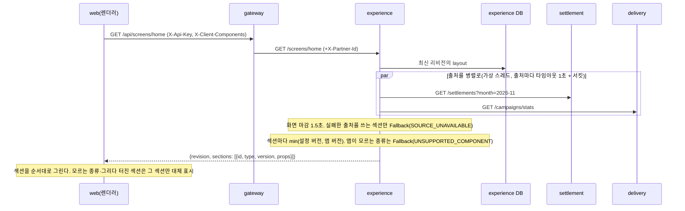
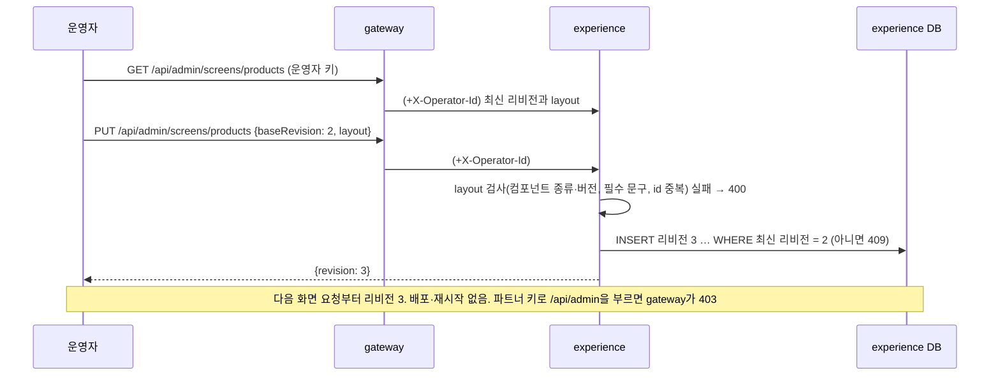

# M4 흐름: 화면 하나가 그려지기까지, 화면을 바꾸기까지

설계 근거는 ADR-0009.

## 그림 1. 파트너 앱이 홈 화면을 그린다



## 그림 2. 운영자가 화면을 바꾼다



## 단계별 DB·상태 변화

| 단계 | DB·상태 |
| --- | --- |
| 화면 조회 | 읽기만 한다(`screen_revisions` 최신 1행). 하위 서비스도 조회만 |
| 출처 실패 | 서킷 상태(실패 기록, 10건 중 50% 넘으면 OPEN 10초). DB 변화 없음 |
| 설정 저장 | `screen_revisions`에 1행 추가(지우거나 고치지 않는다). 되돌리기도 새 행 |

## 실제 실행 로그 (2026-11-22)

### S10 (`bash scripts/experiments/m4.sh s10`)

```
[S10] 운영자가 광고 상품 화면의 환불 안내 문구를 바꾸고 맨 아래로 옮긴다
  바꾸기 전:
    리비전 2
    refund       Banner                   v1  집행 전 캠페인은 전액 환불됩니다. 집행 중에는 쓴 금액을 뺀 나머지를 돌려드립니다.
    products     ProductList              v1
    purchase     PurchaseForm             v1
  저장: {"screenId":"products","revision":3}
  바로 다음 요청(297ms 뒤):
    리비전 3
    products     ProductList              v1
    purchase     PurchaseForm             v1
    refund       Banner                   v1  12월부터 집행 중 환불은 쓴 금액과 수수료 5%를 뺀 나머지를 돌려드립니다.
  구버전 앱도 같은 문구를 받는다:
    12월부터 집행 중 환불은 쓴 금액과 수수료 5%를 뺀 나머지를 돌려드립니다.
  권한·검사:
    파트너 키로 설정 변경 → 403
    낡은 리비전으로 저장 → 409
    모르는 컴포넌트로 저장 → 400
  되돌리기(옛 layout을 새 리비전으로 저장): {"screenId":"products","revision":4}
```

(리비전 2는 첫 실행에서 스크립트가 한글 본문을 잘못 보내 저장이 400으로 실패한 뒤, 되돌리기 단계만 저장된 것이다. 바뀐 내용은 없다.)

### S12 중 experience 로그

```
2026-11-22T03:02:33.282 WARN [omcat-handler-2] 출처 CAMPAIGN_STATS 실패, 그 영역만 대체 표시: org.springframework.web.client.ResourceAccessException: I/O error on GET request for "http://toxiproxy:28084/campaigns/stats": Request cancelled
```

응답 타임아웃(1초)에 걸려 요청이 취소됐고, 이 출처를 쓰는 예산 사용률·성과 섹션만 대체 표시로 나갔다. S11·S12 숫자는 [m4-sdui.md](../04-verification/m4-sdui.md).

통합 테스트: experience 7개, gateway 필터 4개, web 렌더러 5개 모두 통과.
