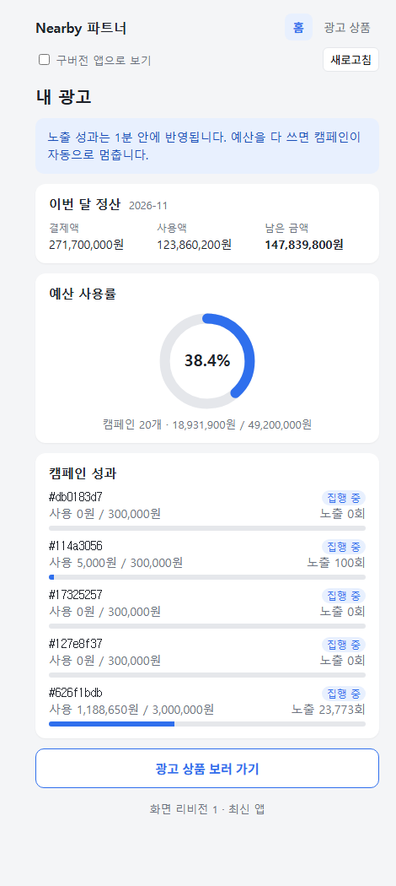
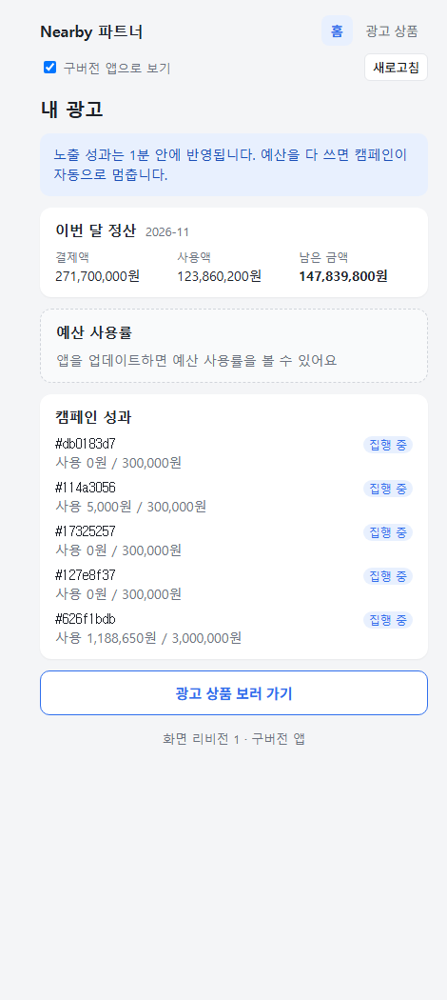
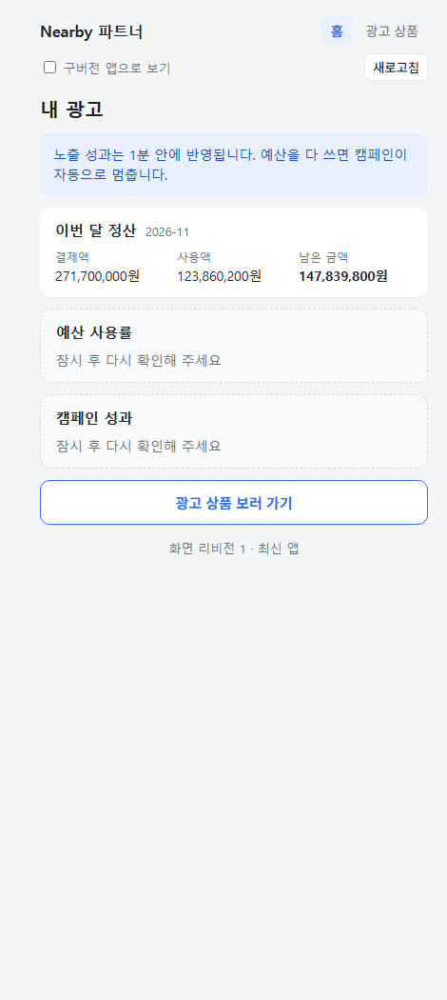
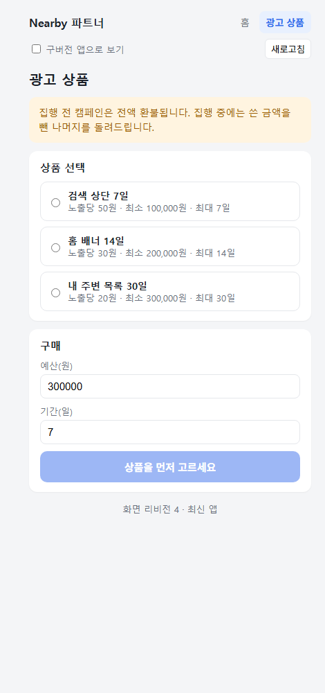

# M4 서버 주도 화면 실험 결과 (S10~S12)

- 날짜: 2026-11-22 · 환경: [검증 README](README.md)의 로컬 compose(web 포함 컨테이너 16개)
- 다시 돌리기: `bash scripts/experiments/m4.sh s10`, `s11`, `s12`, `shots`(화면 캡처)
- 가설(기획 P2): 파트너 앱 화면을 서버가 내려주는 SDUI로 만들면 문구·구성·순서를 앱 배포 없이 바꿀 수 있다. 구버전 클라이언트가 모르는 컴포넌트를 받아도 화면이 깨지지 않고, 하위 서비스가 죽어도 그 영역만 대체 표시된다.

| 최신 앱 | 구버전 앱(S11) | 성과 출처 장애(S12) | 광고 상품·구매 |
| --- | --- | --- | --- |
|  |  |  |  |

## S10. 운영자가 문구와 순서를 바꾼다

광고 상품 화면의 환불 안내 문구를 바꾸고, 맨 위에서 맨 아래로 옮겼다(운영자 키로 `PUT /api/admin/screens/products`).

| 항목 | 결과 |
| --- | --- |
| 반영 시점 | 저장 응답 직후 다음 요청에서 리비전 2 → 3, 순서·문구 반영(배포·재시작 없음) |
| 구버전 앱 | 같은 새 문구를 받는다(정책 문구가 사용자마다 달라지는 문제 P2) |
| 파트너 키로 변경 | 403 |
| 낡은 리비전으로 저장(동시 수정) | 409 |
| 모르는 컴포넌트로 저장 | 400(저장 안 됨) |
| 되돌리기 | 옛 layout을 새 리비전 4로 저장 |

## S11. 구버전 앱이 모르는 컴포넌트를 받는다

같은 홈 화면을 최신 앱과 "BudgetGauge를 모르고 성과 목록 v1까지만 아는" 앱이 받았다(`X-Client-Components`).

| 섹션 | 최신 앱 | 구버전 앱 |
| --- | --- | --- |
| notice | Banner v1 | Banner v1 |
| settlement | SettlementSummary v1 | SettlementSummary v1 |
| gauge | BudgetGauge v1 | **Fallback**("앱을 업데이트하면 예산 사용률을 볼 수 있어요") |
| performance | CampaignPerformanceList **v2**(노출 수·진행률) | CampaignPerformanceList **v1**(두 필드를 빼고 보냄) |
| cta | ActionButton v1 | ActionButton v1 |

서버가 버전을 맞춰 주지 못한 경우(설정 실수 등)에 대비해 렌더러도 모르는 종류를 섹션 단위로 대체 표시하고, 그리다 터진 섹션도 그 섹션만 대체 표시한다(web 테스트 5개).

## S12. 성과 출처(delivery)가 느리거나 죽는다

홈 화면은 정산(settlement)·예산 사용률·성과(delivery) 세 출처를 병렬로 부른다. 출처마다 응답 타임아웃 1초, 서킷 브레이커, 화면 마감 1.5초.

| 상황 | 홈 화면 응답 p50 / p95 / 최대 | 대체 표시된 섹션 | delivery 서킷 |
| --- | --- | --- | --- |
| 평소(20회) | 65 / 128 / 128ms | 없음 | CLOSED |
| delivery 응답 3초 지연(30회) | 63 / 1,027 / 1,029ms | gauge, performance | OPEN |
| delivery 중지(20회) | 57 / 1,315 / 1,315ms | gauge, performance | OPEN |
| 복구 뒤(20회) | 63 / 1,466 / 1,466ms | 없음 | CLOSED |

- 3초짜리 지연에도 화면은 3초를 기다리지 않았다. 처음 몇 번은 응답 타임아웃(1초)만큼 기다렸고, 실패가 쌓여 서킷이 열린 뒤에는 delivery를 부르지 않고 바로 대체 표시를 내려줬다(p50 63ms).
- 공지·정산·버튼은 그대로 그려졌다. 화면 전체가 실패한 요청은 없었다.
- 각 단계 요청 수가 20~30회라 p95가 사실상 가장 느린 한두 번이다. 느린 요청은 서킷이 열리기 전, 반열림에서 시험할 때, 복구 직후 첫 요청이었다.

## 관측
`experience.sections{type, outcome}` 카운터로 섹션마다 ok·downgraded·unsupported_component·source_unavailable 수를 센다. Grafana 패널은 아직 만들지 않았다.

## 가설 판정

| 가설 | 판정 | 근거 |
| --- | --- | --- |
| 문구·구성·순서를 배포 없이 바꾼다 | 맞음 | S10: 저장 직후 다음 요청에 반영, 구버전 앱도 같은 문구 |
| 구버전 클라이언트가 모르는 컴포넌트를 받아도 화면이 깨지지 않는다 | 맞음 | S11: 그 섹션만 대체 표시, 아는 컴포넌트는 버전을 낮춰 보냄 |
| 하위 서비스가 죽어도 그 영역만 대체 표시된다 | 맞음 | S12: 성과 두 영역만 대체 표시, 응답 최대 1.5초 이내 |

## 측정하지 못한 것
- 네이티브 앱(iOS·Android). 렌더러는 웹(React) 하나뿐이다. 같은 스키마를 네이티브가 그릴 때의 비용은 재지 않았다.
- 운영자가 설정을 잘못 바꿨을 때 되돌리기까지 걸리는 시간, 미리보기. 지금은 운영자 API만 있고 편집 화면은 없다.
- 화면 응답 캐시. 같은 화면을 많은 파트너가 동시에 부를 때의 부하는 재지 않았다.
